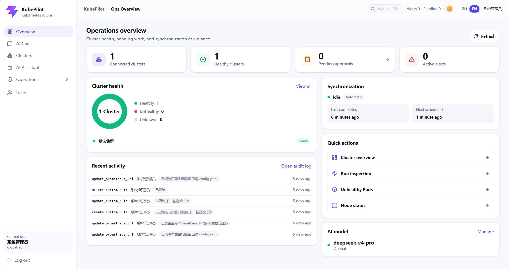

<div align="center">

# KubePilot

**An AI-powered operations platform for multi-cluster Kubernetes environments**

Connect clusters, synchronize resources, detect problems, generate evidence-backed fixes, and execute approved remediation with full audit trails.

[](LICENSE)
[](https://github.com/DevOpsHan/KubePilot/actions/workflows/ci.yml)
[](https://go.dev/)
[](https://react.dev/)
[](#prerequisites)
[](#installation-and-startup)
[](CONTRIBUTING.md)

[简体中文](README_CN.md) · [Installation & Startup](#installation-and-startup) · [Interface](#interface-preview) · [Configuration](#production-or-long-term-configuration) · [Local Development](#local-development) · [Troubleshooting](#troubleshooting) · [Contributing](CONTRIBUTING.md)

</div>

---

## What is KubePilot?

KubePilot is an intelligent operations platform for multi-cluster Kubernetes environments. Instead of stopping at resource visibility, it connects detection, diagnosis, decision, remediation, and verification into one controlled workflow:

- **Connect and synchronize:** import clusters through kubeconfig, maintain isolated runtime clients, and keep resource snapshots available for cross-cluster operations.
- **Inspect and diagnose:** combine scheduled or on-demand inspections, alerts, cluster evidence, and AI-assisted analysis to explain what is happening and why.
- **Approve and remediate:** turn supported recommendations into reviewable tickets, require human approval for controlled actions, and record the execution result.
- **Verify and audit:** check the cluster again after remediation and preserve synchronization, approval, execution, and audit history for later review.

## Interface Preview



The sidebar and command palette are permission-aware. Users see only the entries they are allowed to access, and direct access to a restricted route returns them to **Overview**.

### Navigation

- **Overview** (`/dashboard`): summarizes connected and healthy clusters, pending approvals, active alerts, synchronization timing, recent activity, and the active AI model.
- **AI Chat** (`/chat`): accepts natural-language operations questions, queries cluster resources and status, starts inspections, and returns evidence-backed diagnosis and remediation guidance.
- **Clusters** (`/clusters`): imports and manages kubeconfig-based clusters, runs synchronization, and exposes cluster health, nodes, cached resources, synchronization status, and task history.
- **AI Assistant** (`/models`): manages OpenAI-compatible model endpoints, model names, credentials, generation parameters, connectivity tests, enabled state, and the default model.
- **Operations**: groups the inspection, alert, approval, audit, and policy workflows described below.
- **Inspection Reports** (`/inspect-report`): starts cluster inspections and presents cross-cluster reports, detected anomalies, evidence, and diagnostic details.
- **Alerts** (`/alerts`): filters and analyzes active alerts, acknowledges or resolves them, requests AI diagnosis, manages silences and notifications, and creates remediation tickets when supported.
- **Approvals** (`/approval`): reviews controlled remediation tickets, approves or rejects them, and tracks execution and post-remediation verification.
- **Audit** (`/audit`): centralizes platform operation records and supports filtering by cluster, user, action, and time.
- **Inspection Settings** (`/inspection-settings`): configures built-in and custom inspection rules, inheritance and enablement, Prometheus connectivity, and custom PromQL validation.
- **Users** (`/users`): manages users, roles, cluster grants, account expiration and status, password resets, and soft deletion.
- **Current account / Log out**: identifies the active account and securely ends the current session.

### Header Controls

- **Search** or `Ctrl/Command + K`: opens the command palette and navigates to an available feature by name.
- **Alerts / Pending**: shows the current active-alert and pending-approval counters, refreshed every 30 seconds.
- **Theme**: switches the interface theme.
- **ZH / EN**: switches the complete application interface between Simplified Chinese and English.
- **Account name**: displays the identity currently signed in.

## Installation and Startup

### Prerequisites

- Linux or macOS
- Docker Engine or Docker Desktop
- Docker Compose v2, using the `docker compose` command
- At least 4 GB of available memory is recommended

### First Build and Startup

Clone the repository and enter the project directory:

```bash
git clone https://github.com/DevOpsHan/KubePilot.git
cd KubePilot
```

Build and start all services with one command:

```bash
docker compose up --build -d
```

This command builds the KubePilot Console and KubePilot Core images and starts the following services:

- MySQL 8.4 for business data and resource caching
- Redis 7 for sessions and short-term conversation memory
- `core`: KubePilot Core for APIs, synchronization, inspections, alerts, and remediation orchestration
- `console`: KubePilot Console, serving the React application and the `/api` reverse proxy through Nginx

MySQL, Redis, and KubePilot Core are visible only within the Compose network. Containers communicate through `mysql:3306`, `redis:6379`, and `core:8080`. By default, the host publishes only the KubePilot Console endpoint at `127.0.0.1:5174`. Here, `127.0.0.1` is the host-side bind address, not a container-to-container address, so internal traffic still uses the Compose network.

If `AIOPS_SECRET_KEY` is not set on the first startup, KubePilot Core generates a random 32-byte text key and stores it in the existing `backend-data` volume. The volume name is retained for deployment compatibility. Recreated containers continue to use the same key, so a new user does not need to create a `.env` file first.

Check container status:

```bash
docker compose ps
```

After all four services become `healthy`, open:

```text
http://localhost:5174
```

Default administrator credentials:

```text
Username: admin
Initial password: k8s@ops123
```

The password must be changed on the first login. The default account and built-in Compose passwords are suitable only for local evaluation. Configure `.env` as described below before exposing KubePilot to a public network or using it in production.

### Subsequent Startups

If the images have already been built and the source has not changed, run:

```bash
docker compose up -d
```

After source code or dependency changes, rebuild:

```bash
docker compose up --build -d
```

To update from GitHub:

```bash
git pull
docker compose up --build -d
```

Stop services while preserving data:

```bash
docker compose down
```

View logs:

```bash
docker compose logs -f core
docker compose logs -f console
```

> `docker compose down -v` permanently removes the MySQL, Redis, and generated encryption-key volumes. Run it only when no historical data is needed. When using the generated key, production backups must include both `mysql-data` and `backend-data`. Restoring the database without the original key makes encrypted fields unreadable.

## Production or Long-Term Configuration

Copy the environment variable example:

```bash
cp .env.example .env
```

Review these settings before long-term or production use:

- `AIOPS_SECRET_KEY`: Leave it empty to use the generated persistent key, or set and securely back up an explicit key for long-term use. An explicit value must be exactly 32 UTF-8 bytes. Do not change it after encrypted data has been stored, or historical ciphertext will become unreadable.
- `AIOPS_DB_PASSWORD`: Password for the MySQL application account.
- `AIOPS_DB_ROOT_PASSWORD`: Password for the MySQL root account.
- `AIOPS_FRONTEND_BIND_ADDRESS`: Keep `127.0.0.1` for same-host access or a host-level reverse proxy. Set it to `0.0.0.0` only when direct access through the server IP is required, and protect the endpoint with a firewall and HTTPS.

## Port Configuration

By default, Compose publishes only KubePilot Console on the host loopback address:

- `127.0.0.1:5174`: KubePilot Console, including proxied `/api` and `/health` routes

MySQL, Redis, and KubePilot Core do not publish host ports. Use `docker compose logs` or `docker compose exec` to troubleshoot internal services instead of exposing databases or Redis to the public internet.

If the Console port is already in use, change it in `.env`:

```dotenv
AIOPS_FRONTEND_BIND_ADDRESS=127.0.0.1
AIOPS_FRONTEND_PORT=15174
```

The `AIOPS_FRONTEND_*` variable names are retained for compatibility with existing deployments; they configure KubePilot Console.

Example for direct access through a remote server IP:

```dotenv
AIOPS_FRONTEND_BIND_ADDRESS=0.0.0.0
AIOPS_FRONTEND_PORT=5174
```

Changing the host-side Console address or port does not affect communication inside the Compose network.

If Nginx, Caddy, or another reverse proxy already runs on the host, keep `AIOPS_FRONTEND_BIND_ADDRESS=127.0.0.1` and configure the upstream as `http://127.0.0.1:5174`. Only the reverse proxy's `80/443` ports then need to be exposed publicly.

Health checks in the Compose file also use `localhost` or `127.0.0.1` to access the current container itself. This is separate from KubePilot Core connections to other containers through the `mysql` and `redis` service names.

## Current Capabilities

### Multi-Cluster Management and Resource Synchronization

- Onboard Kubernetes clusters through kubeconfig files and manage up to five clusters.
- Run background automatic synchronization, manual synchronization, and pre-inspection synchronization while recording task source, time, resource counts, and results.
- Cache snapshots of Nodes, Namespaces, Pods, Deployments, DaemonSets, StatefulSets, Services, Ingresses, ConfigMaps, Secret metadata, Jobs, CronJobs, PVCs, PVs, Events, HPAs, CRDs, and other resources.
- When the Kubernetes API Server becomes completely unreachable, mark the cluster and latest synchronization task as failed and show unexecuted incremental work as not executed. Preserve the latest successful resources while clearly identifying them as historical and stale data.
- Inspect resource versions, change counts, full-sync status, incremental rounds, and cached objects.

### Inspections, Alerts, and Notifications

- Run scheduled rule-based inspections in the background and continuously accumulate alerts without automatically consuming model tokens.
- Collect live evidence and perform AI-assisted root cause diagnosis during manual inspections.
- Include built-in Pod, workload, and node-state rules with global and per-cluster overrides.
- Support Prometheus-based CPU, memory, and custom PromQL metric rules.
- Support alert deduplication, occurrence counts, automatic recovery, acknowledgement, resolution, silencing, and trend statistics.
- Send notifications through signed DingTalk robots and WeCom group robots.

### AI Diagnosis, Approval, and Remediation

- Collect container status, Kubernetes Events, and crash logs as model evidence before diagnosis.
- Configure models from KubePilot Console, including OpenAI-compatible endpoints, connection tests, enable/disable controls, and a default model.
- Reply in the primary natural language of the user's latest question. Chinese and English can be switched turn by turn in the same conversation, while commands, logs, YAML, PromQL, and resource names remain unchanged.
- Inject the authenticated account identity and role into each AI conversation. Identity questions are answered deterministically from the server-side session even when no model is enabled, conversation memory is isolated by user, and AI tools are restricted to the account's role permissions and authorized clusters.
- Let AI propose actions while KubePilot Core resolves the actual execution target from trusted cluster objects rather than accepting a model-selected target.
- Require human approval for every write operation.
- Recheck target resources asynchronously after remediation, automatically resolve related alerts after recovery, or mark them for manual intervention when recovery fails.
- Record diagnosis, ticket creation, approval, execution, verification, and configuration changes in the audit log.

### Users and Permissions

- Provide global administrator, cluster administrator, and inspection operator roles.
- Grant non-global roles access to one or more clusters.
- Support user expiration, disabling, mandatory first-login password changes, password resets, and retained soft deletion.
- Expire login sessions after 30 minutes of inactivity and restart the idle window after each successful authenticated request.

### Interface and Internationalization

- Support Chinese and English across all KubePilot Console pages, switchable from the language control in the upper-right corner.
- Store the language choice in the current browser so it persists across refreshes and new logins.
- Re-render navigation, forms, statuses, dates, confirmation dialogs, notifications, and system errors when the language changes.
- Preserve user input, cluster and resource names, model output, logs, YAML, and PromQL as original business data to avoid changing their meaning through translation.

## Technology Stack

- KubePilot Core: Go 1.26, Echo, GORM, client-go, Zap
- KubePilot Console: React 19, TypeScript 6, Vite 8, i18next, react-i18next, Tailwind CSS 4, Radix UI, Lucide
- Database: MySQL 8.4, with SQLite available for local development
- Sessions and cache: Redis 7
- Metrics source: Prometheus HTTP API
- Container entry points: Docker Compose and Nginx

## Main Environment Variables

Base configuration:

- `AIOPS_SECRET_KEY`
- `AIOPS_SERVER_HTTP_ADDR`
- `AIOPS_DATABASE_DRIVER`
- `AIOPS_DATABASE_DSN`
- `AIOPS_REDIS_ADDR`
- `AIOPS_REDIS_PASSWORD`
- `AIOPS_REDIS_DB`
- `AIOPS_ADMIN_USERNAME`
- `AIOPS_ADMIN_DISPLAY_NAME`

Synchronization and inspections:

- `AIOPS_SYNC_ENABLED`
- `AIOPS_SYNC_INTERVAL_SECONDS`
- `AIOPS_SYNC_INITIAL_DELAY_SECONDS`
- `AIOPS_INSPECTION_ENABLED`
- `AIOPS_INSPECTION_INTERVAL_SECONDS`
- `AIOPS_INSPECTION_INITIAL_DELAY_SECONDS`
- `AIOPS_PROMETHEUS_URL`

Notifications:

- `AIOPS_NOTIFY_ENABLED`
- `AIOPS_NOTIFY_MIN_SEVERITY`
- `AIOPS_NOTIFY_RESOLVED`
- `AIOPS_DINGTALK_WEBHOOK`
- `AIOPS_DINGTALK_SECRET`
- `AIOPS_WECOM_WEBHOOK`

Host entry variables used only by Docker Compose:

- `AIOPS_FRONTEND_BIND_ADDRESS`
- `AIOPS_FRONTEND_PORT`

See [`.env.example`](.env.example) and [`config.example.yaml`](config.example.yaml) for complete configuration examples. Notifications, Prometheus, and models can also be configured from the UI and applied immediately.

## Local Development

### KubePilot Core

Prepare a local configuration:

```bash
cp config.example.yaml config.yaml
export AIOPS_SECRET_KEY="0123456789abcdef0123456789abcdef"
```

`config.example.yaml` uses SQLite by default and expects Redis at `localhost:6379`. Start KubePilot Core:

```bash
go run ./cmd/aiops-agent
```

Check KubePilot Core health:

```bash
curl -fsS http://localhost:8080/health
```

### KubePilot Console

```bash
cd web
npm ci
npm run dev
```

Development URL:

```text
http://localhost:5174
```

Vite proxies `/api` to `http://127.0.0.1:8080`.

Use the language control in the upper-right corner to switch between Chinese and English. The selection is stored in browser local storage.

## Migrating from SQLite to MySQL

Stop writes to the source database and back up the SQLite file before migration. Set the source path and target DSN, then run the one-time migration tool:

```bash
export AIOPS_SQLITE_PATH="aiops.db"
export AIOPS_MYSQL_DSN="aiops:password@tcp(127.0.0.1:3306)/aiops?charset=utf8mb4&parseTime=True&loc=Local"
go run ./cmd/dbmigrate
```

After validating the migrated data, switch the application database driver and DSN to MySQL.

## Development Verification

KubePilot Core tests and static checks:

```bash
go test ./... -count=1 -timeout 60s
go vet ./...
go mod tidy -diff
```

KubePilot Console checks:

```bash
cd web
npm run build
npm run lint
```

Compose checks:

```bash
docker compose config --quiet
node scripts/check-compose-security.mjs
docker compose build
node scripts/check-docker-secret.mjs kubepilot-core:local
```

## Troubleshooting

### Containers Do Not Become Healthy

```bash
docker compose ps
docker compose logs --tail=200 mysql redis core console
```

Start with the earliest failing dependency. KubePilot Core depends on healthy MySQL and Redis services, and KubePilot Console depends on a healthy Core service.

### Port Is Already in Use

Do not change internal container ports. Override `AIOPS_FRONTEND_PORT` in `.env` and access the page through the new Console port. MySQL, Redis, and KubePilot Core do not publish host ports.

### Cluster Connection Fails After Import

Confirm that the Kubernetes API Server address in kubeconfig is reachable from the **core container**. Inside a container, `localhost` and `127.0.0.1` refer to that container itself and usually do not represent the host or Kubernetes control plane.

### Historical Resources Show Success While the Cluster Is Disconnected

KubePilot intentionally preserves the latest successful snapshot. The page simultaneously shows the current synchronization failure, unexecuted incremental work, and stale-data status. Historical success does not mean that the cluster is currently reachable.

## Project Structure

```text
cmd/aiops-agent/          Service entry point
cmd/dbmigrate/            One-time SQLite-to-MySQL migration tool
internal/app/             Application assembly
internal/config/          Configuration loading
internal/collector/       Kubernetes collection, synchronization, and evidence collection
internal/clusterruntime/  Multi-cluster runtime management
internal/clustersync/     Cluster synchronization orchestration
internal/inspect/         Inspection engine and rules
internal/prom/            Prometheus query client
internal/ai/              Model protocols and diagnosis
internal/agent/           Intelligent conversation and tool execution
internal/remediate/       Controlled remediation execution
internal/notify/          DingTalk and WeCom notifications
internal/security/        Sensitive-data encryption and decryption
internal/session/         Sessions and conversation memory
internal/server/          HTTP APIs and background scheduling
internal/store/           Data models and persistence
web/                      KubePilot Console (React)
```

## Contribution Guidelines

See [`CONTRIBUTING.md`](CONTRIBUTING.md) for the contribution process and [`SECURITY.md`](SECURITY.md) for vulnerability reporting. Core requirements:

- Keep every feature or bug fix in a focused, clearly described local commit.
- Update the README whenever adding or changing user-visible behavior.
- Check whether Docker Compose, images, or environment variables are affected before every commit.
- Run tests and static checks appropriate to the change before committing.
- Create local commits by default and do not run `git push` without explicit approval.

## Roadmap

- Expand controlled remediation actions and parameter validation.
- Add email, Slack, and generic Webhook notification channels.
- Add SLO, capacity, and multidimensional alert-trend views.
- Add versioned image publishing, image signing, Helm charts, and offline deployment support.

## License

KubePilot is licensed under the [Apache License 2.0](LICENSE), Copyright HanOps.
See [NOTICE](NOTICE) for complete copyright and attribution information.
