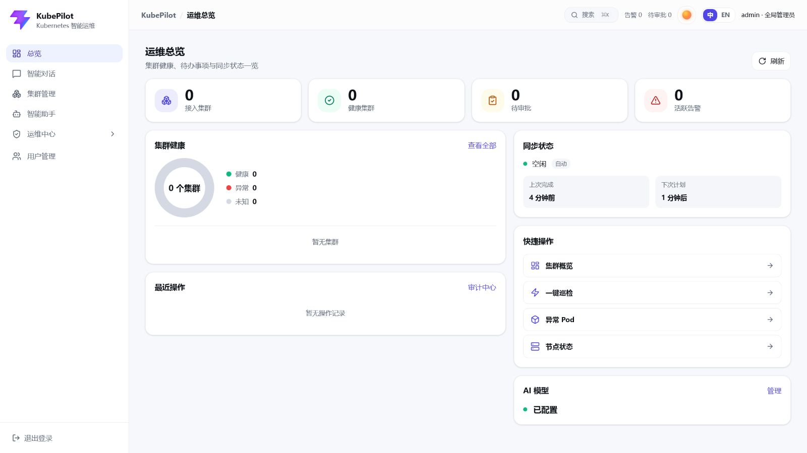

<div align="center">

# KubePilot

**面向 Kubernetes 多集群的 AI 智能运维平台**

从集群接入、资源同步和巡检告警，到 AI 诊断、人工审批、修复执行与审计追踪，形成安全可控的运维闭环。

[](LICENSE)
[](https://github.com/DevOpsHan/KubePilot/actions/workflows/ci.yml)
[](https://go.dev/)
[](https://react.dev/)
[](#环境要求)
[](#安装与启动)
[](CONTRIBUTING.md)

[English](README.md) · [安装与启动](#安装与启动) · [界面展示](#界面展示) · [生产配置](#生产或长期使用配置) · [本地开发](#本地开发) · [常见问题](#常见问题) · [贡献指南](CONTRIBUTING.md)

</div>

---

## 这是什么

KubePilot 是面向 Kubernetes 多集群场景的智能运维平台。它不止展示资源状态，而是把问题发现、诊断决策、受控修复和效果验证组织成一条完整的运维闭环：

- **接入与同步：** 通过 kubeconfig 纳管集群，为每个集群维护独立运行时客户端，并持续同步资源快照，为跨集群运维提供统一数据基础。
- **巡检与诊断：** 结合定时或手动巡检、告警、集群证据与 AI 分析，说明问题发生在哪里、当前影响以及可能原因。
- **审批与修复：** 将受支持的修复建议转换为可审核工单，高风险操作必须经过人工审批，并完整记录执行结果。
- **复检与审计：** 修复后重新检查集群状态，同时保留同步、审批、执行和审计历史，便于复盘与追踪。

## 界面展示



侧边导航和命令面板会根据当前用户的权限动态展示。用户只能看到有权访问的入口，直接访问无权限路由时会返回**总览**。

### 导航功能

- **总览**（`/dashboard`）：集中展示已接入和健康集群、待审批、活跃告警、同步时间、最近操作及当前 AI 模型。
- **智能对话**（`/chat`）：通过自然语言查询集群资源和状态、读取 Pod 日志与现场证据、在容器内执行只读诊断命令、发起巡检，并获取带证据的诊断结果与修复建议。
- **集群管理**（`/clusters`）：通过 kubeconfig 接入和维护集群，执行同步，并持续探测连通性，断连集群立即下调为未连接。集群详情页是一个统一的资源浏览器：顶部「主要信息」分组（基本信息、节点状态、同步状态、命名空间、Event、CRD）位于分组资源（工作负载、网络、配置、存储）之上，各类资源均可按命名空间和名称筛选；点击任意对象在侧栏查看详情并实时获取完整 YAML，Pod 还额外提供实时日志和交互式终端（exec）。
- **智能助手**（`/models`）：管理 OpenAI 兼容的模型地址、模型名称、凭据和生成参数，支持连通性测试、启停模型及设置默认模型。
- **运维中心**：归集下述巡检、告警、审批、审计和规则配置流程。
- **巡检报告**（`/inspect-report`）：发起集群巡检，统一查看多集群巡检报告、异常项、证据和诊断详情。
- **告警中心**（`/alerts`）：筛选和分析活跃告警，确认或解决告警，发起 AI 诊断，管理静默与通知，并在支持时创建修复工单。
- **审批中心**（`/approval`）：审核受控修复工单，执行批准或拒绝，并跟踪修复执行及效果复检结果。
- **审计中心**（`/audit`）：集中记录平台操作，支持按集群、用户、动作和时间筛选审计记录。
- **巡检设置**（`/inspection-settings`）：配置内置与自定义巡检规则、规则继承和启停、Prometheus 连通性及自定义 PromQL 校验。
- **用户管理**（`/users`）：维护用户、角色、集群授权、账号有效期和状态，并支持密码重置与软删除。
- **退出登录**：通过侧边栏底部的退出命令安全结束当前会话。

### 顶部控件

- **搜索**或 `Ctrl/Command + K`：打开命令面板，并按名称跳转到当前可用功能。
- **告警 / 待审批**：展示当前活跃告警数和待审批数，每 30 秒自动刷新。
- **主题**：切换界面主题。
- **中 / EN**：在简体中文与英文完整界面之间切换。
- **登录身份**：右上角仅展示当前认证用户的用户名，并在切换账号后同步更新。

## 安装与启动

### 环境要求

- Linux 或 macOS
- Docker Engine 或 Docker Desktop
- Docker Compose v2（使用 `docker compose` 命令）
- 可用内存建议不低于 4 GB

### 首次构建并启动

克隆项目并进入目录：

```bash
git clone https://github.com/DevOpsHan/KubePilot.git
cd KubePilot
```

一条命令构建并启动全部服务：

```bash
docker compose up --build -d
```

该命令会构建 `kubepilot-console:v0.1` 和 `kubepilot-core:v0.1`，并启动以下服务：

- MySQL 8.4：业务数据和资源缓存
- Redis 7：会话与对话短期记忆
- `core`：KubePilot Core，负责 API、同步、巡检、告警和修复编排
- `console`：KubePilot Console，通过 Nginx 提供 React 应用及 `/api` 反向代理

MySQL、Redis 和 KubePilot Core 只在 Compose 内部网络中可见，容器分别通过
`mysql:3306`、`redis:6379` 和 `core:8080` 通信。宿主机默认只发布
`127.0.0.1:5174` KubePilot Console 入口。这里的 `127.0.0.1` 是宿主机端口的绑定地址，
不是容器互联地址，不会绕过 Compose 网络。

首次启动且未设置 `AIOPS_SECRET_KEY` 时，KubePilot Core 会自动生成长度为 32 字节的随机文本密钥，
并保存到现有的 `backend-data` 卷。该卷名为兼容已有部署而保留；容器重建会继续使用同一密钥，不需要用户预先创建 `.env`。

查看容器状态：

```bash
docker compose ps
```

四个服务进入 `healthy` 状态后访问：

```text
http://localhost:5174
```

默认管理员：

```text
用户名：admin
初始密码：k8s@ops123
```

首次登录必须修改密码。默认账号和 Compose 内置密码只适合本地体验，公开网络或生产环境必须按下文配置 `.env`。

### 后续启动

镜像已经构建且源码没有变化时，可以直接执行：

```bash
docker compose up -d
```

源码或依赖发生变化后重新执行：

```bash
docker compose up --build -d
```

从 GitHub 更新到新版本：

```bash
git pull
docker compose up --build -d
```

停止服务但保留数据：

```bash
docker compose down
```

查看日志：

```bash
docker compose logs -f core
docker compose logs -f console
```

> `docker compose down -v` 会永久删除 MySQL、Redis 和自动生成的加密密钥卷，
> 仅应在确认不需要任何历史数据时执行。使用自动密钥时，生产备份必须同时覆盖
> `mysql-data` 与 `backend-data`；只恢复数据库而没有原密钥，敏感字段将无法解密。

## 生产或长期使用配置

复制环境变量示例：

```bash
cp .env.example .env
```

生产或长期运行前重点确认以下配置：

- `AIOPS_SECRET_KEY`：可留空并使用自动持久化密钥；长期运行建议显式设置并安全备份。若显式设置，必须正好为 32 个 UTF-8 字节。开始保存数据后不得随意更换，否则历史密文无法解密。
- `AIOPS_DB_PASSWORD`：MySQL 业务账号密码。
- `AIOPS_DB_ROOT_PASSWORD`：MySQL root 密码。
- `AIOPS_FRONTEND_BIND_ADDRESS`：同机访问或由宿主机反向代理转发时保留 `127.0.0.1`；需要通过服务器 IP 直接访问时设置为 `0.0.0.0`，并通过防火墙与 HTTPS 限制访问。

## 端口配置

Compose 默认只在宿主机回环地址发布 KubePilot Console：

- `127.0.0.1:5174`：KubePilot Console 页面以及代理后的 `/api`、`/health`

MySQL、Redis 和 KubePilot Core 不发布宿主机端口。需要排查内部服务时使用
`docker compose logs` 或 `docker compose exec`，不要为了调试将数据库和 Redis 暴露到公网。

如果 Console 端口被占用，在 `.env` 中修改：

```dotenv
AIOPS_FRONTEND_BIND_ADDRESS=127.0.0.1
AIOPS_FRONTEND_PORT=15174
```

`AIOPS_FRONTEND_*` 变量名为兼容已有部署而保留，实际用于配置 KubePilot Console。

远程服务器通过 IP 直接访问的示例：

```dotenv
AIOPS_FRONTEND_BIND_ADDRESS=0.0.0.0
AIOPS_FRONTEND_PORT=5174
```

修改宿主机 Console 地址或端口不会影响 Compose 内部服务通信。

如果服务器已经运行 Nginx、Caddy 等宿主机反向代理，可以继续保留
`AIOPS_FRONTEND_BIND_ADDRESS=127.0.0.1`，将反向代理上游设置为
`http://127.0.0.1:5174`。这样公网只需要开放反向代理的 `80/443` 端口。

Compose 文件中的健康检查也会使用 `localhost` 或 `127.0.0.1` 访问当前容器自身；
这与 KubePilot Core 通过 `mysql`、`redis` 服务名访问其他容器是两种不同的网络场景。

## 当前能力

### 多集群与资源同步

- 通过 kubeconfig 接入 Kubernetes 集群，最多管理 5 个集群。
- 支持后台自动同步、手动同步和巡检前同步，并记录任务来源、时间、资源数量和结果。
- 缓存 Node、Namespace、Pod、Deployment、DaemonSet、StatefulSet、Service、Ingress、ConfigMap、Secret 元信息、Job、CronJob、PVC、PV、Event、HPA 和 CRD 等资源快照。
- Kubernetes API Server 网络完全断开时，集群和最新同步任务标记为失败，本轮增量显示为未执行；最近一次成功资源仍会保留，但明确标记为历史记录和数据已过期。
- 集群列表持续探测连通性，断连集群立即下调为未连接。
- 支持查看资源版本、变更数量、全量状态、增量轮次及缓存对象。
- 按分类浏览缓存资源，点击任意对象查看详情并实时获取完整 YAML，Pod 可打开实时日志或交互式只读终端（exec）。

### 巡检、告警与通知

- 后台定时执行规则巡检并持续沉淀告警，不自动消耗大模型 token。
- 手动巡检支持采集现场证据并执行 AI 根因诊断。
- 内置 Pod、工作负载和节点状态规则，支持全局与集群级覆盖。
- 支持基于 Prometheus 的 CPU、内存及自定义 PromQL 指标规则。
- 告警支持去重、计数、自动恢复、确认、解决、静默和趋势统计。
- 支持钉钉加签机器人和企业微信群机器人通知。

### AI 诊断、审批与修复

- 诊断前采集容器状态、Kubernetes Event 和崩溃日志作为模型证据。
- 支持 AI 主动排查：读取 Pod 日志、采集现场证据、执行白名单内的只读 exec 命令；每次 AI 触发的操作在审计记录中同时归属到 AI 与触发用户。
- 模型通过 KubePilot Console 配置，支持 OpenAI 兼容接口、连接测试、启停和默认模型。
- 智能对话按用户最新问题的主要自然语言回复，支持在同一会话中逐轮切换中文和英文；命令、日志、YAML、PromQL 和资源名称保持原文。
- 每轮智能对话注入当前认证账号的身份与角色；即使未启用模型，身份问题也会直接根据服务端会话确定性回答；对话记忆按用户隔离，AI 工具同时受账号角色权限和已授权集群范围约束。
- AI 输出建议动作，但实际执行目标由 KubePilot Core 从集群对象反查，不由模型直接决定。
- 所有写操作必须经过人工审批。
- 修复后异步复检目标资源，恢复后自动解决关联告警，未恢复则标记为待人工介入。
- 诊断、建单、审批、执行、复检及配置变更均写入审计记录。

### 用户与权限

- 支持全局管理员、集群管理员和巡检执行者角色。
- 非全局角色可以授权访问一个或多个集群。
- 支持用户有效期、禁用、首次登录改密、密码重置和软删除保留。
- 登录会话在连续 30 分钟无操作后过期；每次成功认证请求都会重新计算空闲期限。

### 界面与国际化

- KubePilot Console 全部页面支持中文和英文，可通过页面右上角的语言控件即时切换。
- 语言选择保存在当前浏览器中，刷新页面或重新登录后仍会沿用。
- 导航、表单、状态、日期、确认框、通知和系统错误均会随语言切换重新渲染。
- 用户输入、集群与资源名称、模型响应、日志、YAML 和 PromQL 等业务原始数据保持原文，避免翻译改变实际含义。

## 技术栈

- KubePilot Core：Go 1.26、Echo、GORM、client-go、Zap
- KubePilot Console：React 19、TypeScript 6、Vite 8、i18next、react-i18next、Tailwind CSS 4、Radix UI、Lucide
- 数据库：MySQL 8.4；本地开发可使用 SQLite
- 会话与缓存：Redis 7
- 指标源：Prometheus HTTP API
- 容器入口：Docker Compose、Nginx

## 主要环境变量

基础配置：

- `AIOPS_SECRET_KEY`
- `AIOPS_SERVER_HTTP_ADDR`
- `AIOPS_DATABASE_DRIVER`
- `AIOPS_DATABASE_DSN`
- `AIOPS_REDIS_ADDR`
- `AIOPS_REDIS_PASSWORD`
- `AIOPS_REDIS_DB`
- `AIOPS_ADMIN_USERNAME`
- `AIOPS_ADMIN_DISPLAY_NAME`

同步与巡检：

- `AIOPS_SYNC_ENABLED`
- `AIOPS_SYNC_INTERVAL_SECONDS`
- `AIOPS_SYNC_INITIAL_DELAY_SECONDS`
- `AIOPS_INSPECTION_ENABLED`
- `AIOPS_INSPECTION_INTERVAL_SECONDS`
- `AIOPS_INSPECTION_INITIAL_DELAY_SECONDS`
- `AIOPS_PROMETHEUS_URL`

通知：

- `AIOPS_NOTIFY_ENABLED`
- `AIOPS_NOTIFY_MIN_SEVERITY`
- `AIOPS_NOTIFY_RESOLVED`
- `AIOPS_DINGTALK_WEBHOOK`
- `AIOPS_DINGTALK_SECRET`
- `AIOPS_WECOM_WEBHOOK`

宿主机入口变量仅由 Docker Compose 使用：

- `AIOPS_FRONTEND_BIND_ADDRESS`
- `AIOPS_FRONTEND_PORT`

完整配置示例见 [`.env.example`](.env.example) 和 [`config.example.yaml`](config.example.yaml)。通知、Prometheus 和模型也可以在页面中配置并即时生效。

## 本地开发

### KubePilot Core

准备本地配置：

```bash
cp config.example.yaml config.yaml
export AIOPS_SECRET_KEY="$(openssl rand -hex 16)"
```

`config.example.yaml` 默认使用 SQLite，并要求本机 Redis 位于 `localhost:6379`。启动 KubePilot Core：

```bash
go run ./cmd/kubepilot-core
```

健康检查：

```bash
curl -fsS http://localhost:8080/health
```

### KubePilot Console

```bash
cd web
npm ci
npm run dev
```

开发地址：

```text
http://localhost:5174
```

Vite 会把 `/api` 代理到 `http://127.0.0.1:8080`。

页面右上角可在中文和英文之间切换，选择结果保存在浏览器本地存储中。

## SQLite 迁移到 MySQL

迁移前应停止对源数据库的写入并备份 SQLite 文件。设置源文件和目标 DSN 后执行一次性迁移工具：

```bash
export AIOPS_SQLITE_PATH="aiops.db"
export AIOPS_MYSQL_DSN="aiops:password@tcp(127.0.0.1:3306)/aiops?charset=utf8mb4&parseTime=True&loc=Local"
go run ./cmd/dbmigrate
```

迁移完成并验证数据后，再将应用的数据库驱动和 DSN 切换到 MySQL。

## 开发验证

KubePilot Core 测试和静态检查：

```bash
go test ./... -count=1 -timeout 60s
go vet ./...
go mod tidy -diff
```

KubePilot Console 检查：

```bash
cd web
npm run build
npm run lint
```

Compose 检查：

```bash
docker compose config --quiet
node scripts/check-compose-security.mjs
docker compose build
node scripts/check-docker-secret.mjs kubepilot-core:v0.1
```

## 常见问题

### 容器长时间不是 healthy

```bash
docker compose ps
docker compose logs --tail=200 mysql redis core console
```

先处理最前面的依赖服务；KubePilot Core 依赖 MySQL 和 Redis 健康，KubePilot Console 依赖 Core 健康。

### 端口已被占用

不要直接修改容器内部端口，在 `.env` 中覆盖 `AIOPS_FRONTEND_PORT`。
修改后使用新的 Console 端口访问页面；MySQL、Redis 和 KubePilot Core 不发布宿主机端口。

### 集群导入后连接失败

确认 kubeconfig 中的 API Server 地址可以从 **core 容器**访问。`localhost` 或 `127.0.0.1` 在容器内指向容器自身，通常不能代表宿主机或 Kubernetes 控制平面。

### 历史资源显示成功但集群连接失败

这是保留最近一次成功快照的设计。页面会同时显示当前同步失败、增量未执行和数据已过期，历史成功不代表集群当前可达。

## 目录结构

```text
cmd/kubepilot-core/       KubePilot Core 服务入口
cmd/dbmigrate/            SQLite 到 MySQL 一次性迁移工具
internal/app/             应用装配
internal/config/          配置加载
internal/collector/       Kubernetes 采集、同步和证据收集
internal/clusterruntime/  多集群运行时管理
internal/clustersync/     集群同步编排
internal/inspect/         巡检引擎与规则
internal/prom/            Prometheus 查询客户端
internal/ai/              模型协议与诊断
internal/agent/           智能对话与工具执行
internal/remediate/       受控修复执行
internal/notify/          钉钉与企业微信通知
internal/security/        敏感数据加解密
internal/session/         会话与对话记忆
internal/server/          HTTP API 与后台调度
internal/store/           数据模型和持久化
web/                      KubePilot Console（React）
```

## 协作约定

贡献流程见 [`CONTRIBUTING.md`](CONTRIBUTING.md)，安全漏洞报告方式见
[`SECURITY.md`](SECURITY.md)。核心要求：

- 每个功能或 Bug 修复使用独立、清晰的本地 commit。
- 新增或改变用户可见功能时同步更新 README。
- 每次提交前检查 Docker Compose、镜像和环境变量是否受影响。
- 提交前运行与改动范围匹配的测试和静态检查。
- 默认只创建本地提交，不执行 `git push`。

## 后续规划

- 扩展更多受控修复动作及参数校验。
- 增加邮件、Slack 和通用 Webhook 通知渠道。
- 增加 SLO、容量和多维告警趋势视图。
- 增加版本化镜像发布、镜像签名、Helm Chart 和离线部署能力。

## 许可证

KubePilot 采用 [Apache License 2.0](LICENSE) 开源，版权归 HanOps 所有。
完整版权与归属说明见 [NOTICE](NOTICE)。
